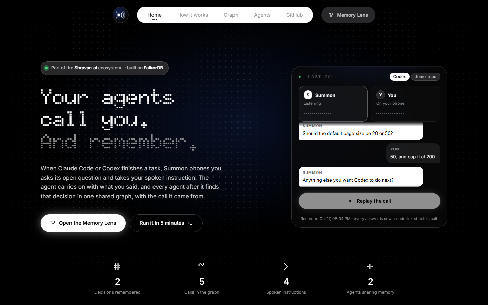
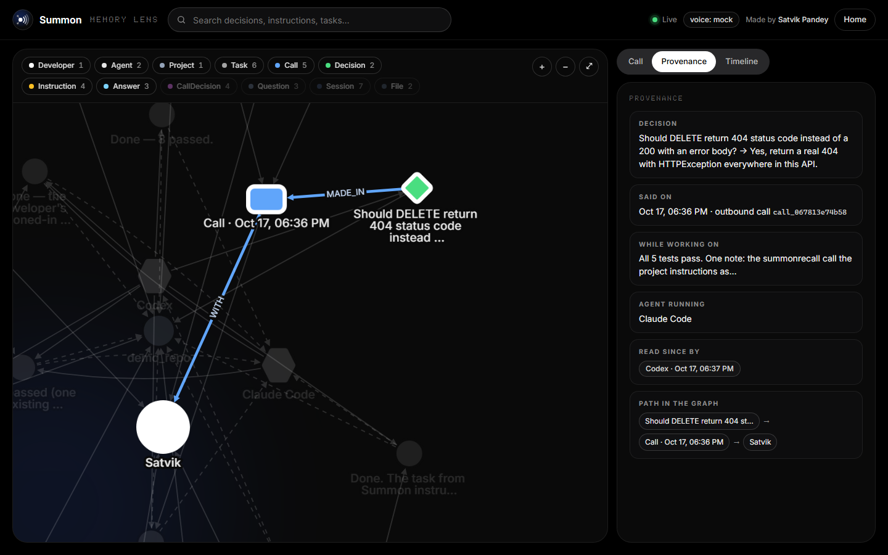

# Summon AI

**Made by Satvik Pandey** · [GitHub @Satvik20Pandey](https://github.com/Satvik20Pandey)

**Your coding agents share one memory — and every decision traces back to you, by phone.**

When Claude Code or Codex finishes a task, Summon phones you, reads the summary, asks its
open question and takes your spoken instruction. The agent continues with what you said.
A different agent, in a fresh session, retrieves that decision from **FalkorDB** together
with the call it came from, and respects it.

Built by Satvik Pandey for [Graph Hacks](https://www.wemakedevs.org/hackathons/falkordb) (WeMakeDevs ×
FalkorDB), Oct 15–18, 2026.
**Tracks entered: 02 Agent Memory and Coordination** (primary) and **01 Agents That Act on
Connected Data**.

- Live: https://summon.shravan-ai.tech (Memory Lens at `/lens`) · mirror that needs no DNS:
  https://summon.77-42-70-237.sslip.io
- Demo video: _(link added at submission)_
- Graph model: [docs/GRAPH_MODEL.md](docs/GRAPH_MODEL.md) · Cypher: [docs/CYPHER.md](docs/CYPHER.md) ·
  Deploy: [docs/DEPLOY.md](docs/DEPLOY.md)





## The loop

```
Claude Code finishes a task ──► Summon calls you ──► "Yes, include the commit hash"
        │                                                      │
        │  Stop hook returns {"decision":"block","reason":<your words>}
        ▼                                                      ▼
Claude continues with your instruction        (:Answer)-[:SAID_IN]->(:Call)  (:Instruction)-[:GIVEN_IN]->(:Call)
        │                                     (:Decision)-[:MADE_IN]->(:Call)-[:WITH]->(:Developer)
        ▼                                                      │
second stop: (:Instruction)-[:EXECUTED_AS]->(:Task)            ▼
                                       Fresh Codex session ──► summon_recall ──► "the developer decided X on call
                                                                                   call_9d3d… at 17:38" ──► respects it
                                                                (:Agent {codex})-[:READ {at}]->(:Decision)
```

Every arrow above is real and was exercised end to end during the hackathon (see
"What was verified").

## What the graph does (not decoration)

| Need | Graph answer | Query |
|---|---|---|
| Where did this rule come from? | `Decision -[:MADE_IN]-> Call -[:WITH]-> Developer`, plus the Task/Session/Agent that were running when you said it, and who has `READ` it since | `provenance()` |
| What did the other agents do while I was away? | Tasks and decisions reachable through `Session -[:RUN_BY]-> Agent ≠ me` since my previous session | `handoff()` |
| What must I know before touching this project? | Current decisions (`until IS NULL`), preferences, answered questions with their call, pending instructions | `brief()` |
| The developer changed their mind | New `Decision` closes the old one and links `SUPERSEDES`; history is never overwritten | `record_decision()` |
| Should the phone ring right now? | Quiet hours learned on an earlier call + calls in the last hour + task priority, written back as a `CallDecision` with its reason | `should_call()` |
| Webhook delivered twice | `MERGE (:Event {id})` gate — one event, one set of facts | `record_event()` |

Full model: [docs/GRAPH_MODEL.md](docs/GRAPH_MODEL.md). Every Cypher statement:
[docs/CYPHER.md](docs/CYPHER.md).

## Run it locally in 5 minutes (no accounts needed)

`SUMMON_VOICE=mock` replaces the phone with a panel in the Memory Lens (or a CLI command).
Everything else — hooks, MCP, curator, graph — is identical to the real thing.

```bash
git clone https://github.com/Satvik20Pandey/Summon-AI && cd Summon-AI
cp .env.example .env                                   # defaults are fine for mock mode
docker run -d --name falkordb -p 6379:6379 falkordb/falkordb:latest   # see "FalkorDB without Docker"
uv sync && uv run summon demo-seed                     # optional: yesterday's memory
uv run summon serve                                    # http://localhost:8787  ->  /lens
```

Wire a project (the demo repo is included):

```bash
uv run summon init examples/demo_repo    # writes .claude/settings.json (Stop hook), .mcp.json,
                                         # .codex/hooks.json, .cursor/mcp.json, ~/.summon/.env
cd examples/demo_repo
claude "add a /version route, then ask me one question"
```

When Claude stops, the Memory Lens rings (**Incoming call**): type your answer and an
instruction and press *Answer & hang up*. Claude continues with your instruction. Then, from
a fresh Codex session (`codex` -> "call summon_recall"), read the decision with its source
call. Prefer a terminal? `uv run summon pending` / `uv run summon answer --a "yes" --more "also ..."`.
`uv run summon demo-reset --yes` wipes your graph and re-seeds it (handy before a demo).

### FalkorDB without Docker
The `falkordblite` wheel ships a FalkorDB server (Linux/macOS). On Windows, run it in WSL:
`wsl -u root -- bash scripts/falkordb-wsl.sh start` (port 6380; set `FALKORDB_PORT=6380`).

## Real phone calls

Summon places calls through the public developer API of
[Shravan.ai](https://shravan-ai.tech) (an Indian voice-agent product; see Disclosure).

```bash
SUMMON_VOICE=sandbox   SHRAVAN_API_KEY=sk_test_…   # free: canned call + real signed webhooks
SUMMON_VOICE=shravan   SHRAVAN_API_KEY=sk_live_…   # real call to SUMMON_DEVELOPER_PHONE
uv run summon setup --webhook-url https://<your-host>/api/webhooks/shravan
# prints SHRAVAN_AGENT_ID and SHRAVAN_WEBHOOK_SECRET → put them in the environment
```

`summon setup` uploads two conversation flows (`summon/voice/flows.py`): *task done*
(outbound) and *inbox* (inbound: you phone the number, dictate a task, `summon daemon`
runs it with Claude or Codex, the Stop hook calls you back). Webhooks are HMAC-SHA256
verified and idempotent; a poll fallback covers a lost webhook.

## The web UI

Summon is part of the [Shravan.ai](https://shravan-ai.tech) ecosystem and uses the same design
language: black canvas, the Doto dot-matrix display face, pill navigation and the dot-grid
"signal field".

- **Landing (`/`)** replays the most recent real call from the graph, shows live memory counts
  and the latest decision the graph made about whether to call.
- **Memory Lens (`/lens`)** is the live FalkorDB graph: filter node types, search memory,
  click any decision to highlight its path back to the call and to you, answer mock calls in
  the browser, and watch agents, calls and the curator in the live timeline (SSE).

## Components

```
summon/
  graph/schema.py     one graph per developer, indexes (range + full-text)
  graph/memory.py     MERGE-based writers; every fact links to its Call
  graph/queries.py    brief · handoff · provenance · should_call · inbox · recall · timeline
  curator.py          condense a task summary to what a call can carry; extract answers /
                      instructions / decisions / preferences from a transcript (LLM, heuristic fallback)
  voice/{base,mock,shravan,flows}.py   provider interface, mock, Shravan client, flow documents
  api/app.py          FastAPI: /api/calls (graph decides, then dials), long-poll from the graph,
                      webhook, memory reads, SSE; serves the Memory Lens
  hooks/stop.py       Stop hook for Claude Code and Codex (block + reason = your words)
  mcp_server.py       summon_recall · summon_remember · summon_done · summon_inbox
  daemon.py           inbox → `claude -p` / `codex exec` inside one chosen directory
web/                  landing page + Memory Lens (cytoscape graph, provenance, search, live timeline)
```

## Speed

FalkorDB sits inside every agent turn, so it has to be fast. Measured with
`summon/graph/queries.py` on this project's own graph (40 nodes; Windows client, FalkorDB in WSL,
200 runs each):

| Read | Queries | p50 | p95 |
|---|---|---|---|
| one hop (Decision -> Call) | 1 | 2.0 ms | 2.5 ms |
| `provenance()` | 3 | 6.0 ms | 8.6 ms |
| `recall()` full-text | 3 | 5.8 ms | 7.2 ms |
| `handoff()` | 3 | 11.3 ms | 13.9 ms |
| `brief()` — what an agent reads before starting | 5 | 14.6 ms | 22.3 ms |

## Integrations

| Agent | Finish → call | Memory |
|---|---|---|
| Claude Code | `.claude/settings.json` Stop hook → `summon hook claude` | `.mcp.json` → `summon-mcp` |
| Codex CLI | `.codex/hooks.json` Stop hook → `summon hook codex` (trust once with `/hooks`) | `codex mcp add summon -- summon-mcp` |
| Cursor | `.cursor/hooks.json` `stop` -> `summon hook cursor` (returns `followup_message`; unit-tested, not yet run in Cursor) | `.cursor/mcp.json` |

`summon init <dir>` writes all of these. The hook is safe to re-fire: one `Call` per task id
(`MERGE`), `stop_hook_active` guard, 900 s budget, and a per-developer cap of 6 calls/hour.

## What was verified

- `uv run pytest`: 26 tests — graph writers and the six queries on a live FalkorDB, flow
  hard rules, signature round-trip and tamper, webhook idempotency through the API, curator
  heuristics, the whole mock loop over HTTP, the Shravan client contract (offline), the
  Cursor hook dialect, and regressions for every bug found in the end-to-end debug pass.
- Every page checked in headless Chrome at 1440x900 and 390x844: no console errors, no
  horizontal overflow, a mock call answered through the UI, provenance and search exercised,
  empty states verified.
- Real `claude -p` run in `examples/demo_repo` with the Stop hook: Claude asked *"Should
  /version also include the git commit hash?"*, the call was answered, Claude implemented
  the spoken instruction, and the follow-up Task was linked `EXECUTED_AS` to the Instruction.
- Real `codex exec` run: `summon_recall` over MCP returned Claude's tasks and the phoned-in
  instruction; Codex left `READ` edges in the graph.

## Disclosure

- **AI coding assistants (Rule 11).** AI coding assistants were used while building this
  project. Every query, hook and architectural choice was designed and reviewed by
  Satvik Pandey and is explained in this README and `docs/`.
- **Pre-existing infrastructure.** Voice calls are placed through the public developer API
  of Shravan.ai, a voice-agent product by the same author that predates the hackathon. It is
  used only as a telephony provider (`POST /v1/agents`, `POST /v1/calls`, signed webhooks),
  the way any customer would; no Shravan.ai code is included and `SUMMON_VOICE=mock` runs the
  whole loop without it. All FalkorDB work, the agent integrations, the curator and this
  service were written during the event.
- **Design.** The web UI follows the Shravan.ai design language; the fonts are Inter and
  Doto (SIL Open Font License, licences in `web/fonts/`) and the graph view uses cytoscape.js
  (MIT), both served from this repo.
- **Data.** The only person in the graph is the author (own data, phone stored hashed);
  demo memory is synthetic (`summon demo-seed`).
- **Prior art.** [call-me](https://github.com/ZeframLou/call-me) and
  [awesome-claude-call](https://github.com/PatterAI/awesome-claude-call) ring your phone when
  Claude finishes; they keep no memory and serve one agent. Graph memory for agents exists
  (Graphiti, Mem0, Cognee on FalkorDB); none has a human on the phone in the loop. Summon is
  the combination: phone-mediated decisions as graph nodes, one memory for every agent, and
  a path from each decision back to the call.

## Author

Made by **Satvik Pandey** — [github.com/Satvik20Pandey](https://github.com/Satvik20Pandey)

## License

MIT © 2026 Satvik Pandey
